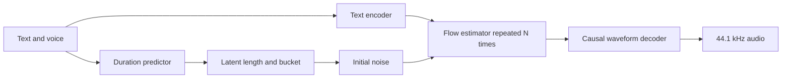

# Supertonic 3 inference bottlenecks on Qualcomm HTP V81

Analysis date: 16 October 2026. Target: Snapdragon X2 Elite X2E84100, QAIRT 2.50.40.260831, ExecuTorch 1.5.0. The conclusions concern this device and compiler combination; the experimental method transfers to other Qualcomm NPUs.

**The highest-priority opportunity is to change the physical representation of the flow model's pointwise MLPs.** Their mathematical work is well suited to the matrix engine, but the surrounding activation, masking, reshaping, and layout handling consume much of the critical path. A new isolated HTP experiment supports a specific solution: pack independent batch/time positions into an 8-row spatial grid around the two pointwise convolutions. At length 96 this reduces the learned MLP from 0.557–0.562 ms to 0.126–0.131 ms, a 4.2–4.5× speedup. This is a measured microbenchmark result, not a full-model speedup.

The next priorities are reducing repeated mask/boundary operations, controlling FP16 error so faster layouts remain usable, and exploiting duplicated classifier-free-guidance computation. Reducing the number of flow evaluations and distilling guidance offer the largest longer-term reductions in required work.

All derived arithmetic, trace summaries, source hashes, saved synthesis measurements, algebra checks, and new microbenchmark timings are in [the evidence snapshot](first-principles-2026-10-16.json). Existing inference programs and presets were not changed by this analysis.

## 1. What the deployed model actually computes

The deployed weights and reconstruction are the source of truth for dimensions. The earlier [SupertonicTTS paper](https://arxiv.org/abs/2503.23108) explains the latent flow-matching, ConvNeXt, and cross-attention design, but its model size should not be substituted for the current Supertonic 3 checkpoint.

The local inference path is:



Each flow evaluation internally processes **two branches**, conditional and unconditional. Public batch size 1 therefore means internal batch size 2. The update is

`x_next = mask * (x + (4 * v_conditional - 3 * v_unconditional) / N)`.

The network contains 28 ConvNeXt blocks: four groups of six, followed by four final blocks. Each has width 512, a depthwise temporal convolution, LayerNorm, and a 512 → 2048 → 512 pointwise MLP with GELU. Each main group also contains time, text, and style conditioning. The vector estimator has 64,013,376 parameters, about 128 MB at FP16 before backend packing. The latent has 144 channels: 24 latent dimensions packed across six codec frames. One flow-frame position covers 3,072 waveform samples, or approximately 69.66 ms.

At a 96-frame audio bucket and 128 text positions, the analytic work is:

| Work | MACs | Interpretation |
|---|---:|---|
| 28 pointwise MLP pairs, both CFG branches | 11.274 billion per flow evaluation | 91.2% of the counted MACs |
| Entire flow estimator | 12.362 billion per evaluation | About 24.724 GFLOPs, before constant folding |
| Eight flow evaluations | 98.895 billion | About 197.790 GFLOPs |
| Vocoder | 14.566 billion once | About 29.131 GFLOPs |
| Flow depthwise convolutions | 0.0138 billion per evaluation | Tiny MAC count; potentially expensive vector/layout work |

These counts include dense conditioning projections before compiler constant folding and omit elementwise arithmetic, normalization reductions, padding, and data movement. One MAC is counted as two FLOPs. They are useful for comparing work, not predicting execution time from advertised TOPS. The pointwise count follows directly from `28 × 2 branches × L × 2 projections × 512 × 2048`.

The vocoder operates at six times the flow sequence length. That increases weight reuse and yields larger matrix operations. Consequently, its useful arithmetic per invocation is greater than one flow evaluation, yet its optimized execution is much faster. In one saved length-96 screen, the vocoder took 5.65 ms while a flow evaluation averaged 17.93 ms. The corresponding analytic work rates are about 5.15 and 1.38 TFLOP/s. These are workload-derived rates, not hardware utilization measurements.

Sources: [configuration](../assets/onnx/tts.json), [vector estimator](../.deps/executorch/examples/models/supertonic/model/vector_estimator.py), [layers](../.deps/executorch/examples/models/supertonic/model/layers.py), [vocoder](../.deps/executorch/examples/models/supertonic/model/vocoder.py).

## 2. The current latency budget

The older eight-step original run measured 359 ms for the main English utterance. Bucketing and the layout vocoder reduced that to 239 ms in its matched screen. More recent matched length-96 tests isolate the narrower `gelu-last` flow change:

| Main English, eight steps, length 96 | Original flow plus layout vocoder | `gelu-last` flow plus same vocoder |
|---|---:|---:|
| Native synthesis median | 199.81 ms | 157.11 ms |
| Flow stage median | 183.51 ms | 143.42 ms |
| Duration predictor median | 3.46 ms | 3.45 ms |
| Text encoder median | 4.19 ms | 4.13 ms |
| Vocoder median | 5.72 ms | 5.65 ms |

The synthesis result is approximately 21.4% faster, with bit-identical final outputs in that paired comparison. Independent stage medians need not add to the synthesis median. The source is [the seed-42 qualification](../artifacts/pointwise/qualification-seed42/summary.json), with 15 warm requests per case. Other length-96 cases in that screen improved by roughly 12–21%. Length 128 improved by about 11–12% in forward and reversed 31-warm-request screens.

There is a severe shape cliff: applying `gelu-last` at length 64 increased short-English synthesis from 113.7 to 317.7 ms in the full-bucket screen. A successful representation must be chosen per bucket and compiler version. Smaller logical shapes do not guarantee faster physical kernels.

For the 157 ms case, flow accounts for about 91% of latency. Even eliminating the remaining vocoder entirely would save only about 3.6%. Per-request subtraction of all native forward spans leaves a median of **0.303 ms** for the explicit host orchestration/copies inside the synthesis interval. Backend launch, RPC, synchronization, and buffer handling inside `Module.forward` are excluded from that 0.303 ms figure.

This explains the observed limited return from unrolling. Existing reuse4/reuse8 graphs preserve outputs in the recorded comparisons, but their latency ranking changes across screens. Removing host crossings does not remove the repeated flow computation or its internal layout operations. After those operations become faster, launch overhead may deserve another measurement.

## 3. Hardware traces point to vector work and physical representation

The two available full HTP Optrace captures have matching provenance and compiler schematics. They represent **synthetic component inputs under instrumentation**. The summary's dominant path is more informative than summing durations across parallel worker threads. Neither is an ordinary synthesis timing measurement.

| Trace-reported quantity | `pointwise-2d`, L96 | `gelu-last`, L96 |
|---|---:|---:|
| HTP active timeline | 99.71% | 99.71% |
| HMX active timeline | 19.06% | 29.55% |
| Individual HVX lane utilization range | 60.2–68.8% | 54.5–63.6% |
| DMA active timeline | 3.99% | 3.65% |
| DRAM traffic | 197.53 MB | 139.08 MB |
| VTCM traffic | 3.489 GB | 3.343 GB |
| Peak VTCM allocation | 8.131 MB | 7.223 MB |
| Executed HTP operation instances | 30,579 | 35,423 |

HMX is the matrix engine; HVX performs vector work. A nearly continuously busy HTP can spend much of its time on work that feeds, transforms, or masks the matrix computations. The faster layout even has **more** physical operation instances. Operator count alone is an inadequate optimization objective.

For `gelu-last`, the QNN-attributed dominant-path shares are:

| QNN operation category | Dominant-path share |
|---|---:|
| GELU | 24.28% |
| Conv2d | 17.77% |
| Transpose | 15.24% |
| Elementwise multiply | 10.89% |
| Reshape | 9.31% |
| Depthwise convolution | 5.74% |
| ReduceSum | 4.63% |
| LayerNorm | 2.14% |
| Attention MatMul | 1.37% |

This grouping attributes internal kernels to source operations. It differs from grouping by physical kernel type: for example, the physical HMX convolution kernel has a 26.47% dominant-path share because it also implements other source operations. Neither table should be treated as a partition of unprofiled production wall time.

The standalone `q::Gelu.fp16.tcm` HVX kernels are visible in both captures. That establishes separate GELU execution for these graphs, beyond merely observing an unfused operator name in an exported graph. It does not imply that QNN cannot fuse GELU in other representations. Qualcomm documents advanced activation fusion as a backend option; actual kernel selection still has to be inspected. [QNN HTP documentation](https://docs.qualcomm.com/doc/80-63442-10/topic/htp_backend.html)

The SDK reports these traffic quantities from its analysis; they are not a direct measurement of peak memory-controller utilization. Low DMA occupancy and the dominant path do not support declaring the current graph primarily DRAM-bandwidth-bound. They also do not prove that on-chip bandwidth is saturated: costly vector arithmetic, padding, tiling, and scheduling can produce the same broad symptoms.

Sources: [gelu-last trace summary](../artifacts/pointwise/profiles/optrace-gelu-last/vector_estimator/chrometrace_qnn_htp_analysis_summary.json), [pointwise trace summary](../artifacts/pointwise/profiles/optrace-pointwise/vector_estimator/chrometrace_qnn_htp_analysis_summary.json), and their `provenance.json` siblings. These captures were produced by the existing profiling work and inspected here.

## 4. A specific explanation and a new hardware experiment

Across 28 blocks, the logical FP16 GELU tensor volume in one direction is

`28 × 2 × 96 × 2048 × 2 bytes = 22,020,096 bytes`.

The trace attributes **176,160,768 bytes read and the same written** to GELU in `pointwise-2d`: exactly 8× the logical volume. `gelu-last` reports **88,080,384 bytes in each direction**: exactly 4×.

This is consistent with blocked-layout padding. The installed SDK's `include/QNN/HTP/core/memory_layout.h` defines 16-bit Crouton tiles with an 8-row dimension, including `R4Crouton2Layout` with 8×4×32 chunks. A fake image with height 1 can therefore create substantial physical padding. The trace shows pointwise GELU tiles shaped `[1, 1, 96, 128]`, each reporting 196,608 bytes read versus 24,576 logical bytes. This is much stronger evidence than an inference from transpose counts alone. The precise selection of internal formats remains compiler-dependent.

At the level of one MLP, the logical expanded activation is about 0.786 MB. Eightfold inflation makes it 6.291 MB. Two such buffers exceed the graph's requested 8 MB VTCM allocation before weights and residuals are considered. The two pointwise weight matrices themselves total about 4.194 MB at FP16. Keeping activations compact can materially improve both vector work and the working set. An OpTrace of the proposed packed graph would be needed to verify which of these effects causes its measured gain.

**Proposed packing:** pointwise operations treat every batch/time position independently. For CFG batch 2 and length 96, reshape the 192 rows into NHWC `[1, 8, 24, 512]`, apply the two pointwise convolutions and GELU, then restore the original shape. The expanded tensor becomes `[1, 8, 24, 2048]`. Both spatial dimensions fit the documented 8×4 tiling without the singleton-height problem.

This rearrangement must be limited to operations independent across positions. Applying the same fake-image interpretation to the temporal depthwise convolution would change the model and could mix CFG branches. LayerNorm can be included only while preserving its channel reduction axis, affine parameters, and epsilon.

The new experiment compiled five representations of the **first flow block's actual learned pointwise MLP**, at lengths 64, 96, and 128. All 15 programs contained one QNN delegate with zero CPU compute fallback. Compilation finished before measurement. Each program was measured in a separate persistent native ARM64 process, with five discarded calls followed by 40 warm calls; the whole sweep was repeated in reverse order. Profiling was disabled. The Windows power plan was Balanced; the existing compiler helper requests HTP Burst.

| Isolated MLP representation | L64 median ms | L96 median ms | L128 median ms |
|---|---:|---:|---:|
| Original Conv1d pair | 0.298–0.387 | 0.557–0.562 | 0.602–0.667 |
| `gelu-last` | 1.227–3.177 | 0.398–0.467 | 0.520–0.521 |
| Rank-four singleton-height pair | 0.416–0.429 | 0.625–0.633 | 2.383–2.397 |
| **Packed 8-row Conv2d pair** | **0.097–0.106** | **0.126–0.131** | **0.152–0.154** |
| Channel-last linear pair | 0.168–0.178 | 0.243–0.251 | 0.308–0.329 |

The intervals are the two sweep medians, not confidence intervals. The substantial L64 `gelu-last` variation reinforces the need for repeated paired measurement. Packed execution was faster in both orders at every tested length, including about 1.85–1.99× versus linear at L96.

The packed MLP's FP32 eager relative L2 discrepancy was below 7.4e-7. On HTP, relative L2 error versus FP32 was 0.056–0.060%. **Its device outputs were bit-identical to the linear MLP's outputs on these inputs, and differed from the original Conv1d path.** Preserving convolution syntax does not preserve backend rounding. The earlier full channel-last flow accuracy failures make this an explicit qualification concern.

The immediate next experiment is to integrate this packing into the 28 flow MLPs in a separate full-model artifact, keeping temporal convolution, masking, and normalization unchanged initially. Measure latency and per-step drift on sensitive utterances before expanding the rewrite. The microbenchmark includes graph-boundary costs and a different surrounding graph, so multiplying its speedup by all 28 blocks would not establish an end-to-end result.

Reproduction: [probe script](../scripts/probe_pointwise_layout.py), [raw result summary](../artifacts/first-principles/pointwise-probe/summary.json). Choose a fresh output directory when rerunning; the script refuses to overwrite evidence.

## 5. Remove work introduced by padding and scalar broadcasts

The current masked-padding correction is necessary: original Supertonic convolutions replicate the last valid position. Zero-padding a bucket changes valid outputs near the boundary. However, the correction currently computes the last valid value through a full tensor multiply and reduction in every ConvNeXt block:

`last_valid = sum((inputs * mask) * terminal_mask, axis=time)`.

Because the masks are contiguous valid prefixes, the same value is `inputs[..., valid_length - 1]`. The native runner already knows that length. A gather using a prepared index, or a boundary-aware convolution kernel, can remove repeated reductions and intermediate broadcasts. The eager check reproduced the original reduction bit-for-bit for finite inputs with the supported binary mask. Dynamic gather performance and QNN support for the chosen index representation must still be checked.

A stronger custom implementation would clamp the temporal read index at the valid sequence boundary, compute the depthwise output, normalize, and avoid materializing the fully extended tensor. Invalid output positions must retain the model's semantics. Masking is not generally removable just because the input is zero: normalization and projection biases can generate nonzero invalid positions.

Other algebraic opportunities include folding fixed channel scales into pointwise weights:

- For LayerNorm affine output `z * a + b` followed by `W1`, use `W1' = W1 diag(a)` and `b1' = W1 b + b1`, retaining the actual normalization reduction.
- Fold the ConvNeXt residual scale into the second projection: `W2' = diag(gamma) W2`, `b2' = gamma * b2`.
- Remove adjacent identical binary-mask multiplications only when their intervening operations preserve the required invariant.

These identities are exact over real arithmetic but can change FP16 rounding. Inspect the compiled graph first because some constant folding may already occur. The target is the measured multiply/reduction/layout critical path, not a reduction in Python source length. Whole MLP or block fusion becomes especially attractive once compact packing makes the working set fit better.

Source: [mask-aware and layout rewrites](../scripts/qnn_transformations.py).

## 6. Exploit the actual structure of classifier-free guidance

There are two useful algebraic opportunities beyond the already implemented conditioning cache.

**Share the prefix before the first text-conditioning operation.** Both branches begin with the same noisy latent, time, and mask. Input projection, four initial ConvNeXt blocks, time conditioning, and one more ConvNeXt block therefore have identical mathematical outputs. Compute that prefix at batch 1, duplicate the result, and continue at batch 2 where text conditioning first differs.

This saves one branch of five of the 28 ConvNeXt blocks on every flow evaluation. The dense arithmetic model estimates **1.015 billion MACs per evaluation, or 8.2% of total counted flow MACs**. It saves 8.9% of pointwise MACs. Latency need not improve by exactly those percentages because smaller batch shapes can change kernel efficiency. Eager FP32 checks at all three buckets had relative L2 error below 1.4e-7; they were not bit-exact because changing batch shape changed floating-point execution.

**Collapse unconditional text attention to a constant.** Its text context repeats a single learned token at every text position. Consequently, every value vector is the same. For valid queries,

`softmax(scores) @ [v, v, ..., v] = v`.

Rotary position encoding changes query/key scores, but not this identity because it does not rotate the values in this implementation. The entire unconditional text-attention result can be precomputed as `out_fc(W_value(unconditional_token))`, then broadcast and masked. Preserve the following residual addition and normalization. The text mask must have at least one valid key, which the runtime contract already requires.

Checks with all four learned attention modules and 1, 73, and 128 valid text positions yielded relative L2 differences below 3.3e-7 in FP32. Floating-point softmax sums need not be exactly one, so device bit parity is not guaranteed. The constant replacement removes only the unconditional text attention; it does not remove unconditional style attention or the rest of the branch. Its arithmetic opportunity is smaller than prefix sharing and overlaps the savings from caching invariant projections.

Text keys/values, voice-dependent style values, and fixed-schedule time projections remain useful caches. The existing `reuseN`/`specialN` prototypes already address them. Avoid claiming these savings a second time. Latent-dependent queries and ConvNeXt activations change at every flow step and cannot be cached exactly across steps.

Sources: [guidance and conditioning implementation](../.deps/executorch/examples/models/supertonic/model/vector_estimator.py), [existing flow reuse](../scripts/flow_unroll.py), [new algebra checks](first-principles-2026-10-16.json).

## 7. Precision work can unlock speed improvements

The current baseline already has seed-sensitive failures against FP32 ONNX, and the broader channel-last flow rewrite introduced additional failures. These are not solved by demonstrating an isolated layer's small error. The guided update propagates errors through subsequent flow evaluations:

`delta_next ≈ (I + dt * J_guided) delta + dt * (4 e_conditional - 3 e_unconditional)`.

The bound on new guidance error is `4 ||e_conditional|| + 3 ||e_unconditional||`. Common-mode error cancels differently from opposite-sign error; the bound does not mean all errors are amplified sevenfold. The flow Jacobian and subsequent decoder determine the final effect.

A targeted experiment is to keep guidance subtraction and the latent update in FP32 while retaining FP16 network computation. The present estimator returns an already updated latent. A diagnostic wrapper could instead return the two velocity tensors, letting the native host perform FP32 guidance and Euler integration. The current eight-call path already crosses the host boundary each step; at L96 the latent is only 55,296 FP32 bytes, and two velocity tensors are about 111 KB. Measure the additional conversion/copy cost, and compare per-step drift. A true FP32 device implementation is another option if the backend demonstrably executes those operations at that precision.

FP16 → FP32 → FP16 casts alone do not improve an already FP16-rounded value. The arithmetic, or persistent accumulated state, must change precision. In particular, public FP32 tensors do not establish FP32 internal accumulation.

Before quantization, compare original FP32, reconstructed FP32, original HTP, packed HTP, and packed HTP with the higher-precision update. Identify the first divergent block and timestep. A broad switch to FP32 is likely to surrender too much performance; a small sensitive region may provide a better tradeoff.

For PTQ, the recorded full A16W8 recipe already had significant eager error and much larger device error. The affine-only recipe split into 37 delegates with CPU computation remaining. This is evidence against those recipes, not against every quantized representation. A useful next sequence is a single pointwise pair, one complete block, one flow step, and then a closed trajectory. Check eager Q/DQ versus device outputs, scales, saturation, and delegation at each stage. A16W16 can help separate activation calibration issues from aggressive weight quantization if supported for the selected operations.

Calibration must cover timesteps, both guidance branches, voices, languages, and the altered trajectories produced by the candidate itself. Existing calibration already samples timesteps; adding that alone is not a new fix. [Q-Diffusion](https://arxiv.org/abs/2302.04304) provides relevant evidence for time-dependent distributions and diffusion-specific calibration, but its image-model results do not establish a working Supertonic quantization recipe.

## 8. Fewer evaluations offer the largest structural gains

For the saved 157.11 ms example, treat about 143.42 ms as flow and the remaining 13.70 ms as fixed. Holding per-evaluation cost constant gives these planning estimates:

| Flow evaluations | Estimated synthesis time | Status |
|---|---:|---|
| 8 | 157 ms | Measured reference case |
| 5 | 103 ms | Arithmetic projection |
| 4 | 85 ms | Arithmetic projection |
| 2 | 50 ms | Arithmetic projection |

The existing five-step conservative measurements are encouraging, but matching five-step ONNX does not establish equivalent quality to an eight-step teacher. Evaluate word correctness, repetitions/omissions, speaker similarity, prosody, and listening quality at each step count.

Nonuniform time schedules are worth testing before retraining. [Empirically Pruned Step Sampling](https://arxiv.org/abs/2505.19931) demonstrates the approach on F5-TTS and E2 TTS. The transferable idea is to allocate evaluations where the trajectory needs them; the reported speedups and schedules are not Supertonic measurements. In this repository, changing the schedule requires separating model time `t_i` from integration width `dt_i`: the current estimator ties both to `current_step / total_step` and `1 / total_step`. Simply skipping integer steps would apply the wrong integration widths. Compare solvers by network function evaluations; a two-stage solver generally spends two evaluations per integration step.

Distilling the guided field into a conditional-only student removes the second network branch. Combining four evaluations with one branch reduces nominal flow work to about one quarter of today's eight-evaluation CFG work. Under the simple fixed-cost model that corresponds to about 50 ms, or 3.2× overall, before additional kernel improvements. That is a research target, not a prediction of achieved quality or hardware scaling. [Towards Flow-Matching-based TTS without Classifier-Free Guidance](https://arxiv.org/abs/2504.20334) demonstrates a training objective that approximates guided trajectories in F5-TTS. It supports investigating guidance distillation here; it does not justify dropping the unconditional branch from the existing checkpoint.

A teacher can supervise a smaller or narrower student as well. Since the dominant MLP work scales roughly with width squared and block count, architecture reduction has clear compute benefits. Training and qualification across the deployment languages and voices are substantial parts of that project.

## 9. Runtime, bucketing, and custom-kernel priorities

More audio buckets can reduce padded temporal work. The 5.77-second example requires 83 frames but executes 96. The maximum temporal work reduction from eliminating that padding is about 13.5%, before fixed and weight-transfer costs. Candidate lengths such as 32, 48, 64, 80, 96, 112, and 128 are worth an empirical sweep, with tile geometry considered alongside capacity. Text bucketing has less immediate leverage because the repeated MLP work is over audio positions; it becomes more useful for frontend latency and larger contexts.

Many separately compiled buckets replicate roughly 140 MB flow programs. Weight sharing and a bounded cache can matter for startup and memory footprint. The runner already keeps loaded modules alive within a process, but each new CLI process starts a new runner. For interactive latency, keep the service alive and report process startup, model loading, first request, and time to first audio separately from warm synthesis. The original recorded first request was 718 ms, which shows why warm RTF alone cannot characterize that experience.

The helper currently defaults to HTP Burst. Windows Balanced is a different policy and does not imply HTP Balanced mode. Thus, “turn on Burst” is not an untried optimization here. Confirm effective clocks and sustained behavior, and compare repeated randomized A/B blocks. Unchanged models have already varied substantially between sessions. Shared buffers and reduced host copies can be useful after measuring their actual backend contribution; the explicit C++ copies currently occupy a very small budget.

The 8 MB VTCM value is a compiler request added for this target, not a verified statement of total hardware capacity. Query supported configurations before testing larger allocations. A larger allocation could reduce spills, but the newer layout already has much less DRAM writing; simply increasing VTCM does not remove padded vector arithmetic.

If graph rewrites stop improving the critical path, implement a compact-layout block or MLP as a custom HTP operation. Preserve tiled intermediates across HMX projections and HVX activation/normalization, fuse scalar/mask operations, and overlap weight movement with useful work. [Qualcomm's Hexagon-MLIR](https://github.com/qualcomm/hexagon-mlir) and its [compiler paper](https://arxiv.org/abs/2602.19762) provide concrete machinery for fusion, tiling, HVX vectorization, and DMA overlap. The paper's large GELU vectorization gains compare its own compiler variants, not the already vectorized QNN kernels observed here. Windows/V81 deployment support must be verified before treating this as a drop-in toolchain.

The [MNN Hexagon operator implementation](https://github.com/alibaba/MNN/tree/master/source/backend/hexagon/htp-ops-lib) is another useful primary implementation reference for FP16 HMX layouts and HVX activation approximations. Its documented deployment target is Android, so porting it is a separate engineering effort. An explicit tanh GELU rewrite already failed to improve this repository's full-pipeline timing; another approximation is only interesting if it maps to a better fused/vector kernel and preserves audio quality.

The relevant lesson from [FlashAttention](https://arxiv.org/abs/2205.14135) is to minimize intermediate materialization around useful computation. Attention itself is a relatively small target at current sequence lengths: all text/style attention products account for only about 1% of the counted flow MACs. Applying that IO-aware approach to ConvNeXt MLPs and boundary handling is likely to matter more here than starting with a custom attention kernel.

Streaming should be considered separately from throughput. The vocoder is causal and could retain state, but it is already a small fraction of warm latency. The flow network uses noncausal temporal convolutions. Summing its dilations gives a nominal one-evaluation temporal receptive field of 289 packed latent positions, larger than the current buckets. Naively synthesizing independent short chunks therefore changes context and boundary behavior. Low first-audio latency may require chunk-aware generation, overlap/qualification, or training changes; it is not obtained simply by making the current vocoder stream.

## 10. A practical order of experiments

| Priority | Experiment | Evidence and plausible payoff | Acceptance test |
|---|---|---|---|
| 1 | Integrate 8-row packing into flow MLPs | New 3.1–4.5× isolated MLP speedups across tested buckets | Whole-request A/B latency, per-step errors, difficult voices/texts/seeds |
| 2 | Gather last valid frame; simplify/fuse masks and channel scales | Multiply/reduction/layout work remains a large dominant-path share | Exact boundary semantics, per-block comparison, no CPU fallback |
| 3 | FP32 guidance and latent accumulation experiment | Could make faster FP16 layouts usable on sensitive trajectories | Compare drift against the same FP32 teacher and measure added overhead |
| 4 | Share the CFG prefix; collapse unconditional text attention | About 8.2% counted MACs saved by prefix sharing; algebra probes pass | Device numerical qualification and batch-shape timing |
| 5 | Evaluate 5/4-step schedules and learned nonuniform times | Reduces the dominant repeated work directly | Same-teacher quality comparison, multilingual ASR and listening |
| 6 | Revisit quantization block by block | Potential weight, arithmetic, and cache gains; current recipes fail | Eager/device agreement, saturation checks, trajectory-aware quality |
| 7 | Guided/few-step distillation and narrower architecture | Largest reduction in required network work | Training plus full quality and deployment evaluation |
| 8 | Custom fused block/kernel implementation | Direct control over layout, padding, vector work, and data movement | Supported Windows/V81 runtime, physical trace, end-to-end benefit |

Use one frozen corpus containing short/long utterances, numbers, punctuation, difficult alignments, language switches where supported, all target voices, and several noise seeds. The existing inherited long-English and seed-43 Spanish errors should remain explicit cases. Compare a candidate against both the current HTP baseline and FP32 reference: equality to the baseline does not repair its existing inaccuracies. Numerical gates detect regressions, while intelligibility, speaker similarity, and listening decide whether a faster approximate method meets the product's quality requirement.

For performance, finish compilation before timing; disable profiling; record model hashes, bucket, schedule, power settings, and run order; use repeated interleaved A/B blocks and paired distributions. Collect a separate matched OpTrace for explanations. Do not compare historical absolute medians as if they were one controlled experiment, add overlapping operator-cycle percentages, or multiply independent microbenchmark speedups together.

Reproduce the analysis and algebra checks with:

```powershell
python scripts/analyze_bottlenecks.py --probe-algebra
```

Reproduce the isolated hardware experiment in a fresh directory with:

```powershell
python scripts/probe_pointwise_layout.py --output artifacts/first-principles/pointwise-probe-new
```

The research additions are [the analysis script](../scripts/analyze_bottlenecks.py), [the hardware probe](../scripts/probe_pointwise_layout.py), this note, and [the evidence snapshot](first-principles-2026-10-16.json). The proposed whole-model transformations remain experiments to implement and qualify.
